# task graph

```mermaid
flowchart TD
  task_0["<workspace>/#b%c"]
  task_1["<workspace>/packages/p#q#build"]
  task_2["<workspace>/packages/ui#build"]
  task_3["<workspace>/packages/ui#postbuild"]
  task_4["<workspace>/packages/ui#prebuild"]
  task_5["<workspace>/packages/web#build"]
  task_6["<workspace>/packages/web#cd"]
  task_7["<workspace>/packages/web#in-src"]
  task_8["<workspace>/packages/web#pipe"]
  task_9["<workspace>/packages/web#steps"]
```



## `<workspace>/#b%c`

```json
{
  "task_display": {
    "package_name": "run-plan",
    "task_name": "b%c",
    "package_path": "<workspace>/"
  },
  "resolved_config": {
    "commands": [
      "echo id"
    ],
    "resolved_options": {
      "cwd": "<workspace>/",
      "cache_config": {
        "remote_cache_allowed": true,
        "env_config": {
          "fingerprinted_envs": [],
          "untracked_env": [
            "<default untracked envs>"
          ]
        },
        "input_config": {
          "includes_auto": true,
          "positive_globs": [],
          "negative_globs": []
        },
        "output_config": {
          "includes_auto": true,
          "positive_globs": [],
          "negative_globs": []
        }
      }
    }
  },
  "source": "PackageJsonScript"
}
```

## `<workspace>/packages/p#q#build`

```json
{
  "task_display": {
    "package_name": "p-q",
    "task_name": "build",
    "package_path": "<workspace>/packages/p#q"
  },
  "resolved_config": {
    "commands": [
      "echo built"
    ],
    "resolved_options": {
      "cwd": "<workspace>/packages/p#q",
      "cache_config": {
        "remote_cache_allowed": true,
        "env_config": {
          "fingerprinted_envs": [],
          "untracked_env": [
            "<default untracked envs>"
          ]
        },
        "input_config": {
          "includes_auto": true,
          "positive_globs": [],
          "negative_globs": []
        },
        "output_config": {
          "includes_auto": true,
          "positive_globs": [],
          "negative_globs": []
        }
      }
    }
  },
  "source": "PackageJsonScript"
}
```

## `<workspace>/packages/ui#build`

```json
{
  "task_display": {
    "package_name": "@acme/ui",
    "task_name": "build",
    "package_path": "<workspace>/packages/ui"
  },
  "resolved_config": {
    "commands": [
      "vtt print build"
    ],
    "resolved_options": {
      "cwd": "<workspace>/packages/ui",
      "cache_config": {
        "remote_cache_allowed": true,
        "env_config": {
          "fingerprinted_envs": [],
          "untracked_env": [
            "<default untracked envs>"
          ]
        },
        "input_config": {
          "includes_auto": true,
          "positive_globs": [],
          "negative_globs": []
        },
        "output_config": {
          "includes_auto": true,
          "positive_globs": [],
          "negative_globs": []
        }
      }
    }
  },
  "source": "PackageJsonScript"
}
```

## `<workspace>/packages/ui#postbuild`

```json
{
  "task_display": {
    "package_name": "@acme/ui",
    "task_name": "postbuild",
    "package_path": "<workspace>/packages/ui"
  },
  "resolved_config": {
    "commands": [
      "vtt print post"
    ],
    "resolved_options": {
      "cwd": "<workspace>/packages/ui",
      "cache_config": {
        "remote_cache_allowed": true,
        "env_config": {
          "fingerprinted_envs": [],
          "untracked_env": [
            "<default untracked envs>"
          ]
        },
        "input_config": {
          "includes_auto": true,
          "positive_globs": [],
          "negative_globs": []
        },
        "output_config": {
          "includes_auto": true,
          "positive_globs": [],
          "negative_globs": []
        }
      }
    }
  },
  "source": "PackageJsonScript"
}
```

## `<workspace>/packages/ui#prebuild`

```json
{
  "task_display": {
    "package_name": "@acme/ui",
    "task_name": "prebuild",
    "package_path": "<workspace>/packages/ui"
  },
  "resolved_config": {
    "commands": [
      "vtt print pre"
    ],
    "resolved_options": {
      "cwd": "<workspace>/packages/ui",
      "cache_config": {
        "remote_cache_allowed": true,
        "env_config": {
          "fingerprinted_envs": [],
          "untracked_env": [
            "<default untracked envs>"
          ]
        },
        "input_config": {
          "includes_auto": true,
          "positive_globs": [],
          "negative_globs": []
        },
        "output_config": {
          "includes_auto": true,
          "positive_globs": [],
          "negative_globs": []
        }
      }
    }
  },
  "source": "PackageJsonScript"
}
```

## `<workspace>/packages/web#build`

```json
{
  "task_display": {
    "package_name": "@acme/web",
    "task_name": "build",
    "package_path": "<workspace>/packages/web"
  },
  "resolved_config": {
    "commands": [
      "tool build"
    ],
    "resolved_options": {
      "cwd": "<workspace>/packages/web",
      "cache_config": {
        "remote_cache_allowed": true,
        "env_config": {
          "fingerprinted_envs": [],
          "untracked_env": [
            "<default untracked envs>"
          ]
        },
        "input_config": {
          "includes_auto": true,
          "positive_globs": [],
          "negative_globs": []
        },
        "output_config": {
          "includes_auto": true,
          "positive_globs": [],
          "negative_globs": []
        }
      }
    }
  },
  "source": "TaskConfig"
}
```

## `<workspace>/packages/web#cd`

```json
{
  "task_display": {
    "package_name": "@acme/web",
    "task_name": "cd",
    "package_path": "<workspace>/packages/web"
  },
  "resolved_config": {
    "commands": [
      "cd src && vtt print in-src"
    ],
    "resolved_options": {
      "cwd": "<workspace>/packages/web",
      "cache_config": {
        "remote_cache_allowed": true,
        "env_config": {
          "fingerprinted_envs": [],
          "untracked_env": [
            "<default untracked envs>"
          ]
        },
        "input_config": {
          "includes_auto": true,
          "positive_globs": [],
          "negative_globs": []
        },
        "output_config": {
          "includes_auto": true,
          "positive_globs": [],
          "negative_globs": []
        }
      }
    }
  },
  "source": "TaskConfig"
}
```

## `<workspace>/packages/web#in-src`

```json
{
  "task_display": {
    "package_name": "@acme/web",
    "task_name": "in-src",
    "package_path": "<workspace>/packages/web"
  },
  "resolved_config": {
    "commands": [
      "vtt print in-src"
    ],
    "resolved_options": {
      "cwd": "<workspace>/packages/web/src",
      "cache_config": {
        "remote_cache_allowed": true,
        "env_config": {
          "fingerprinted_envs": [],
          "untracked_env": [
            "<default untracked envs>"
          ]
        },
        "input_config": {
          "includes_auto": true,
          "positive_globs": [],
          "negative_globs": []
        },
        "output_config": {
          "includes_auto": true,
          "positive_globs": [],
          "negative_globs": []
        }
      }
    }
  },
  "source": "TaskConfig"
}
```

## `<workspace>/packages/web#pipe`

```json
{
  "task_display": {
    "package_name": "@acme/web",
    "task_name": "pipe",
    "package_path": "<workspace>/packages/web"
  },
  "resolved_config": {
    "commands": [
      "vtt print a | vtt print b"
    ],
    "resolved_options": {
      "cwd": "<workspace>/packages/web",
      "cache_config": {
        "remote_cache_allowed": true,
        "env_config": {
          "fingerprinted_envs": [],
          "untracked_env": [
            "<default untracked envs>"
          ]
        },
        "input_config": {
          "includes_auto": true,
          "positive_globs": [],
          "negative_globs": []
        },
        "output_config": {
          "includes_auto": true,
          "positive_globs": [],
          "negative_globs": []
        }
      }
    }
  },
  "source": "TaskConfig"
}
```

## `<workspace>/packages/web#steps`

```json
{
  "task_display": {
    "package_name": "@acme/web",
    "task_name": "steps",
    "package_path": "<workspace>/packages/web"
  },
  "resolved_config": {
    "commands": [
      "vtt print one && echo two"
    ],
    "resolved_options": {
      "cwd": "<workspace>/packages/web",
      "cache_config": {
        "remote_cache_allowed": true,
        "env_config": {
          "fingerprinted_envs": [],
          "untracked_env": [
            "<default untracked envs>"
          ]
        },
        "input_config": {
          "includes_auto": true,
          "positive_globs": [],
          "negative_globs": []
        },
        "output_config": {
          "includes_auto": true,
          "positive_globs": [],
          "negative_globs": []
        }
      }
    }
  },
  "source": "TaskConfig"
}
```

