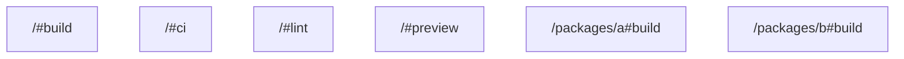

# task graph



## `<workspace>/#build`

```json
{
  "task_display": {
    "package_name": "nested",
    "task_name": "build",
    "package_path": "<workspace>/"
  },
  "resolved_config": {
    "commands": [
      "vt run --filter a build"
    ],
    "resolved_options": {
      "cwd": "<workspace>/",
      "cache_config": {
        "remote_cache_allowed": true,
        "env_config": {
          "fingerprinted_envs": [],
          "untracked_env": [
            "<default untracked envs>"
          ]
        },
        "input_config": {
          "includes_auto": true,
          "positive_globs": [],
          "negative_globs": []
        },
        "output_config": {
          "includes_auto": true,
          "positive_globs": [],
          "negative_globs": []
        }
      }
    }
  },
  "source": "PackageJsonScript"
}
```

## `<workspace>/#ci`

```json
{
  "task_display": {
    "package_name": "nested",
    "task_name": "ci",
    "package_path": "<workspace>/"
  },
  "resolved_config": {
    "commands": [
      "vt run -r build && vt run lint"
    ],
    "resolved_options": {
      "cwd": "<workspace>/",
      "cache_config": {
        "remote_cache_allowed": true,
        "env_config": {
          "fingerprinted_envs": [],
          "untracked_env": [
            "<default untracked envs>"
          ]
        },
        "input_config": {
          "includes_auto": true,
          "positive_globs": [],
          "negative_globs": []
        },
        "output_config": {
          "includes_auto": true,
          "positive_globs": [],
          "negative_globs": []
        }
      }
    }
  },
  "source": "PackageJsonScript"
}
```

## `<workspace>/#lint`

```json
{
  "task_display": {
    "package_name": "nested",
    "task_name": "lint",
    "package_path": "<workspace>/"
  },
  "resolved_config": {
    "commands": [
      "vtt print lint"
    ],
    "resolved_options": {
      "cwd": "<workspace>/",
      "cache_config": {
        "remote_cache_allowed": true,
        "env_config": {
          "fingerprinted_envs": [],
          "untracked_env": [
            "<default untracked envs>"
          ]
        },
        "input_config": {
          "includes_auto": true,
          "positive_globs": [],
          "negative_globs": []
        },
        "output_config": {
          "includes_auto": true,
          "positive_globs": [],
          "negative_globs": []
        }
      }
    }
  },
  "source": "PackageJsonScript"
}
```

## `<workspace>/#preview`

```json
{
  "task_display": {
    "package_name": "nested",
    "task_name": "preview",
    "package_path": "<workspace>/"
  },
  "resolved_config": {
    "commands": [
      "vt run --dry-run lint"
    ],
    "resolved_options": {
      "cwd": "<workspace>/",
      "cache_config": {
        "remote_cache_allowed": true,
        "env_config": {
          "fingerprinted_envs": [],
          "untracked_env": [
            "<default untracked envs>"
          ]
        },
        "input_config": {
          "includes_auto": true,
          "positive_globs": [],
          "negative_globs": []
        },
        "output_config": {
          "includes_auto": true,
          "positive_globs": [],
          "negative_globs": []
        }
      }
    }
  },
  "source": "PackageJsonScript"
}
```

## `<workspace>/packages/a#build`

```json
{
  "task_display": {
    "package_name": "a",
    "task_name": "build",
    "package_path": "<workspace>/packages/a"
  },
  "resolved_config": {
    "commands": [
      "vtt print a"
    ],
    "resolved_options": {
      "cwd": "<workspace>/packages/a",
      "cache_config": {
        "remote_cache_allowed": true,
        "env_config": {
          "fingerprinted_envs": [],
          "untracked_env": [
            "<default untracked envs>"
          ]
        },
        "input_config": {
          "includes_auto": true,
          "positive_globs": [],
          "negative_globs": []
        },
        "output_config": {
          "includes_auto": true,
          "positive_globs": [],
          "negative_globs": []
        }
      }
    }
  },
  "source": "PackageJsonScript"
}
```

## `<workspace>/packages/b#build`

```json
{
  "task_display": {
    "package_name": "b",
    "task_name": "build",
    "package_path": "<workspace>/packages/b"
  },
  "resolved_config": {
    "commands": [
      "vtt print b"
    ],
    "resolved_options": {
      "cwd": "<workspace>/packages/b",
      "cache_config": {
        "remote_cache_allowed": true,
        "env_config": {
          "fingerprinted_envs": [],
          "untracked_env": [
            "<default untracked envs>"
          ]
        },
        "input_config": {
          "includes_auto": true,
          "positive_globs": [],
          "negative_globs": []
        },
        "output_config": {
          "includes_auto": true,
          "positive_globs": [],
          "negative_globs": []
        }
      }
    }
  },
  "source": "PackageJsonScript"
}
```

