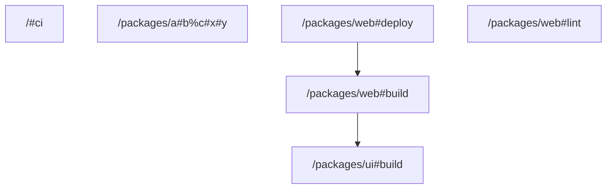

# task graph



## `<workspace>/#ci`

```json
{
  "task_display": {
    "package_name": "task-graph-json-test",
    "task_name": "ci",
    "package_path": "<workspace>/"
  },
  "resolved_config": {
    "commands": [
      "vt run -r lint",
      "vt run -r build"
    ],
    "resolved_options": {
      "cwd": "<workspace>/",
      "cache_config": {
        "remote_cache_allowed": true,
        "env_config": {
          "fingerprinted_envs": [],
          "untracked_env": [
            "<default untracked envs>"
          ]
        },
        "input_config": {
          "includes_auto": true,
          "positive_globs": [],
          "negative_globs": []
        },
        "output_config": {
          "includes_auto": true,
          "positive_globs": [],
          "negative_globs": []
        }
      }
    }
  },
  "source": "TaskConfig"
}
```

## `<workspace>/packages/a#b%c#x#y`

```json
{
  "task_display": {
    "package_name": "@test/odd",
    "task_name": "x#y",
    "package_path": "<workspace>/packages/a#b%c"
  },
  "resolved_config": {
    "commands": [
      "echo x"
    ],
    "resolved_options": {
      "cwd": "<workspace>/packages/a#b%c",
      "cache_config": {
        "remote_cache_allowed": true,
        "env_config": {
          "fingerprinted_envs": [],
          "untracked_env": [
            "<default untracked envs>"
          ]
        },
        "input_config": {
          "includes_auto": true,
          "positive_globs": [],
          "negative_globs": []
        },
        "output_config": {
          "includes_auto": true,
          "positive_globs": [],
          "negative_globs": []
        }
      }
    }
  },
  "source": "PackageJsonScript"
}
```

## `<workspace>/packages/ui#build`

```json
{
  "task_display": {
    "package_name": "@test/ui",
    "task_name": "build",
    "package_path": "<workspace>/packages/ui"
  },
  "resolved_config": {
    "commands": [
      "tsdown"
    ],
    "resolved_options": {
      "cwd": "<workspace>/packages/ui",
      "cache_config": {
        "remote_cache_allowed": true,
        "env_config": {
          "fingerprinted_envs": [],
          "untracked_env": [
            "<default untracked envs>"
          ]
        },
        "input_config": {
          "includes_auto": true,
          "positive_globs": [],
          "negative_globs": []
        },
        "output_config": {
          "includes_auto": true,
          "positive_globs": [],
          "negative_globs": []
        }
      }
    }
  },
  "source": "PackageJsonScript"
}
```

## `<workspace>/packages/web#build`

```json
{
  "task_display": {
    "package_name": "@test/web",
    "task_name": "build",
    "package_path": "<workspace>/packages/web"
  },
  "resolved_config": {
    "commands": [
      "vite build"
    ],
    "resolved_options": {
      "cwd": "<workspace>/packages/web",
      "cache_config": {
        "remote_cache_allowed": true,
        "env_config": {
          "fingerprinted_envs": [],
          "untracked_env": [
            "<default untracked envs>"
          ]
        },
        "input_config": {
          "includes_auto": true,
          "positive_globs": [],
          "negative_globs": []
        },
        "output_config": {
          "includes_auto": true,
          "positive_globs": [],
          "negative_globs": []
        }
      }
    }
  },
  "source": "TaskConfig"
}
```

## `<workspace>/packages/web#deploy`

```json
{
  "task_display": {
    "package_name": "@test/web",
    "task_name": "deploy",
    "package_path": "<workspace>/packages/web"
  },
  "resolved_config": {
    "commands": [
      "wrangler deploy"
    ],
    "resolved_options": {
      "cwd": "<workspace>/packages/web/infra",
      "cache_config": {
        "remote_cache_allowed": true,
        "env_config": {
          "fingerprinted_envs": [],
          "untracked_env": [
            "<default untracked envs>"
          ]
        },
        "input_config": {
          "includes_auto": true,
          "positive_globs": [],
          "negative_globs": []
        },
        "output_config": {
          "includes_auto": true,
          "positive_globs": [],
          "negative_globs": []
        }
      }
    }
  },
  "source": "TaskConfig"
}
```

## `<workspace>/packages/web#lint`

```json
{
  "task_display": {
    "package_name": "@test/web",
    "task_name": "lint",
    "package_path": "<workspace>/packages/web"
  },
  "resolved_config": {
    "commands": [
      "oxlint"
    ],
    "resolved_options": {
      "cwd": "<workspace>/packages/web/..",
      "cache_config": {
        "remote_cache_allowed": true,
        "env_config": {
          "fingerprinted_envs": [],
          "untracked_env": [
            "<default untracked envs>"
          ]
        },
        "input_config": {
          "includes_auto": true,
          "positive_globs": [],
          "negative_globs": []
        },
        "output_config": {
          "includes_auto": true,
          "positive_globs": [],
          "negative_globs": []
        }
      }
    }
  },
  "source": "TaskConfig"
}
```

